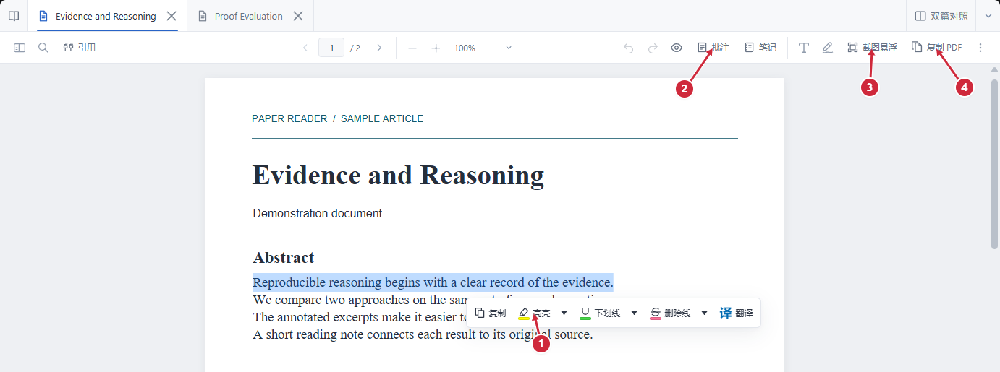
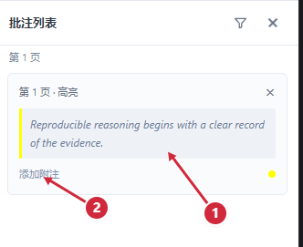

# Paper Reader 使用说明

在 VS Code 中管理本地论文、阅读和批注 PDF。支持 Windows 和 macOS。

从 [最新发行版](https://github.com/zkyqust/Paper-Reader-Releases/releases/latest) 下载 VSIX。打开 VS Code 的「扩展」面板，点 `…` → **从 VSIX 安装**，安装后重新加载窗口。

## 管理和搜索论文

1. 点文件夹图标，选择本地文献库。
2. 用「跨文献全文搜索」查找 PDF 正文，点结果跳到原文。
3. 用「搜索论文」按题目、显示名称或文件夹筛选，匹配的目录会展开到论文。
4. 点击论文开始阅读。右键可改显示名称、移动或复制到其他分类。

- **左侧论文可以直接拖动**。把论文拖到目标文件夹那一行的中间，看到文件夹高亮后松手，即可移动到该文件夹。
- **拖动排序**。在同一文件夹里，把论文拖到另一篇论文的上半部或下半部，按蓝色插入线所示的位置放下。

### 显示名称和论文题目

1. **修改显示名称**。给当前文件夹里的这份 PDF 起一个别名。从该分类打开时，文献列表和阅读标签都显示这个名称。
2. **重命名论文题目**。更正插件从 PDF 自动读取的题目。论文题目是插件识别论文的依据，用于同一文献库里的**分组和查重**。不同文件夹下的同题副本归为一组，共享已保存的批注和引用。

比如论文题目都是 `Transformer`，在「综述」里的副本可以显示为「Transformer · 综述」，在「精读」里的副本可以显示为「Transformer · 精读」。

## 添加论文

右键目标文件夹，选 **添加论文…**。① 选文件、拖入 PDF 或文件夹，也可以点击虚线区域后粘贴。② 在清单里勾选要导入的论文。③ 点 **完成**，将选中的 PDF 添加到上方显示的分类。

## 阅读、批注和截图

1. 选中文字后，可以复制、高亮、画下划线、加删除线或翻译。每种标记工具可以分别设置常用颜色。
2. 点 **批注** 打开列表，跳转到标记的位置或添加附注。批注自动保存到 PDF。
3. 点 **截图悬浮** 后框选内容，截图会打开为可置顶的桌面浮窗。
4. 点 **复制 PDF**，可把 PDF 粘贴到文件管理器。先用眼睛图标隐藏批注再复制，可获得无批注副本。

① 点摘录跳回原文。② 点 **添加附注**，为这条标记补一段笔记。 在 PDF 上双击已有的高亮、下划线或删除线，或在批注列表中双击对应的摘录，即可查看和编辑该标记的附注。

## 双篇对照

打开至少两篇论文，点④ **双篇对照**，也可以把一个标签拖到阅读区右侧。①、② 左右各自选论文。**同组内拖动论文标签可以排序，拖到另一侧可以换组。** ③ 拖动中间分隔线，松开后调整两侧宽度。

## 保存和导出引用

点阅读器工具栏的 **引用**。① 粘贴论文的 BibTeX。② 点 **保存**，将引用关联到这篇论文。然后可复制 BibTeX 或 `cite`。需要批量导出时，**右键文献文件夹 → 导出文件夹引用…**，勾选论文后导出 `.bib`。

## 跨设备阅读

用 **WPS 云盘或 OneDrive 同步整个文献库，包括 PDF 和 `.paper-reader/`**。一台电脑保存并同步完成后，在另一台电脑的插件中打开同步后的本地文件夹。
