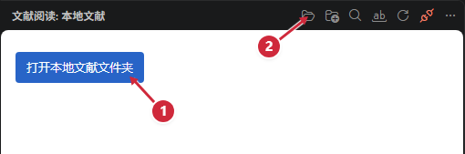
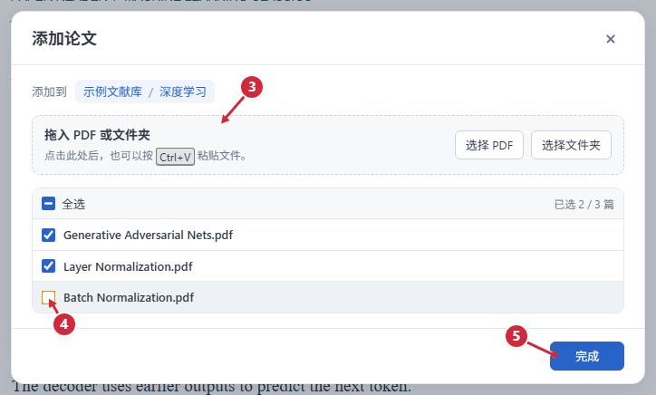
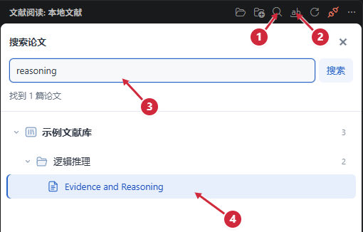
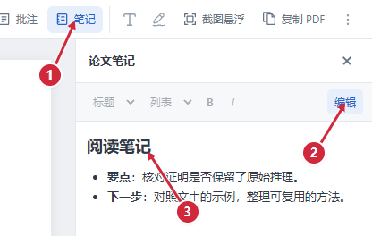
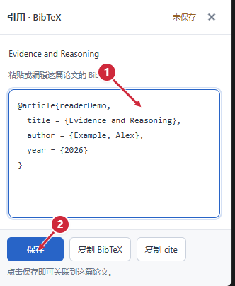

# Paper Reader 使用说明

在 VS Code 中管理本地论文、阅读和批注 PDF。支持 Windows 和 macOS。

## 安装或更新

[直接下载 Paper Reader v0.10.100（VSIX）](https://github.com/zkyqust/Paper-Reader-Releases/releases/download/v0.10.100/paper-reader-local-0.10.100.vsix)。打开 VS Code 的「扩展」面板，点 `…` → **从 VSIX 安装**，安装后重新加载窗口。

## 打开本地文献文件夹

**文献库文件夹就是 PDF 在电脑上的实际存放位置。** 安装插件后，在左侧「文献阅读」面板点 **打开本地文献文件夹**，选择一个空文件夹，或直接打开已有 PDF 的文件夹。以后导入的 PDF 会保存到这个文件夹或你选中的子文件夹。

**可以同时打开多个文献库。** 点击图中箭头指向的文件夹图标，可以继续添加其他文件夹，也可以在选择窗口里一次选中多个。已打开的文献库会一起显示在左侧，可以分别展开和阅读。

## 导入 PDF

右键目标文件夹，选 **添加论文…**。① 选文件、拖入 PDF 或文件夹，也可以点击虚线区域后粘贴。② 在清单里勾选要导入的论文。③ 点 **完成**，将选中的 PDF 添加到上方显示的分类。

## 管理和搜索论文

1. 点文件夹图标，选择本地文献库。
2. 用「跨文献全文搜索」查找 PDF 正文，点结果跳到原文。
3. 用「搜索论文」按题目、显示名称或文件夹筛选，匹配的目录会展开到论文。
4. 点击论文开始阅读。右键可改显示名称、移动或复制到其他分类。

- **左侧论文可以直接拖动**。把论文拖到目标文件夹那一行的中间，看到文件夹高亮后松手，即可移动到该文件夹。
- **拖动排序**。在同一文件夹里，把论文拖到另一篇论文的上半部或下半部，按蓝色插入线所示的位置放下。

### 显示名称和论文题目

1. **修改显示名称**。设置**当前分类中这份 PDF 的显示名**。该分类的文献列表会显示这个名称，从这里打开时，阅读标签也会使用它。每个分类可以分别设置。
2. **论文题目**由插件从 PDF 自动读取，作为**整个文献库（主文件夹及其子分类）中识别论文的唯一标记**，用于分组和查重。不同分类里的同题副本归为一组，按组同步 **PDF 内容、批注和已保存的引用**。识别有误时，可用菜单里的「重命名论文题目」更正。

比如论文题目都是 `Transformer`，在「综述」里的副本可以显示为「Transformer · 综述」，在「精读」里的副本可以显示为「Transformer · 精读」。

## 阅读、批注和笔记

1. 选中文字后，可以复制、高亮、画下划线、加删除线或翻译。每种标记工具可以分别设置常用颜色。
2. 点 **批注** 打开列表，跳转到标记的位置或添加附注。批注自动保存到 PDF。
3. 点 **截图悬浮** 后框选内容，截图会打开为可置顶的桌面浮窗。
4. 点 **复制 PDF**，再粘贴到文件管理器。可以按批注的显示状态选择要复制的版本。

① 点摘录跳回原文。② 点 **添加附注**，为这条标记补一段笔记。 在 PDF 上双击已有的高亮、下划线或删除线，或在批注列表中双击对应的摘录，即可查看和编辑该标记的附注。

### 论文笔记

点 **批注** 右侧的 **笔记**，可以记录整篇论文的心得。支持标题、项目列表、编号列表、加粗、斜体和预览。笔记自动保存到 PDF，重新打开文件就能继续编辑。

### 右侧栏自动翻译

第一次选中文字后，点选区菜单的 **翻译**。点翻译窗口右上角、关闭按钮左边的**侧栏图标**，即可在浮窗和右侧栏之间切换，插件会记住上次选择。

**右侧栏打开时**，在 PDF 中选中文字并松开鼠标，右栏就会自动更新原文和译文。浮窗模式可用选区菜单的 **翻译** 按钮触发。支持 DeepL、百度、有道和阿里云，可通过齿轮按钮配置服务。

### 复制 PDF

- **要保留批注和笔记**，在批注显示时点 **复制 PDF**。
- **要生成干净副本**，先点**眼睛图标**隐藏全部批注，再点 **复制 PDF**。副本会移除批注和论文笔记，原文件继续保留你的记录。

复制后可以粘贴到桌面或文件夹。下图的蓝框标出眼睛图标和复制按钮。

### 跳转参考文献后返回

点击正文里可跳转的参考文献编号，会定位到对应条目。看完后点阅读区底部的① **↑ 回到刚才位置**，就能回到点编号前的那一页和滚动位置。

## 双篇对照

打开至少两篇论文，点④ **双篇对照**，也可以把一个标签拖到阅读区右侧。①、② 左右各自选论文。**同组内拖动论文标签可以排序，拖到另一侧可以换组。** ③ 拖动中间分隔线，松开后调整两侧宽度。

## PDF 缓存设置

1. 点文献阅读标签栏左边的书本图标，打开 **PDF 缓存**。
2. 在 **最多缓存** 中输入 `1–100` 篇，默认是 **20 篇**。
3. 点 **应用**，设置生效后弹窗自动收起。
4. **已缓存 2 / 20 篇**表示当前窗口缓存了 2 篇，最多缓存 20 篇。

缓存上限控制最近访问的 PDF 有多少篇留在内存里。上限越小越省内存，较早访问的论文会释放缓存，标签仍可点击，切回时重新加载。**每个窗口独立计数**。双篇对照时会保留正在看的两篇。

## 保存和导出引用

点阅读器工具栏的 **引用**。① 粘贴论文的 BibTeX。② 点 **保存**，将引用关联到这篇论文。然后可复制 BibTeX 或 `cite`。需要批量导出时，**右键文献文件夹 → 导出文件夹引用…**，勾选论文后导出 `.bib`。

## 跨设备阅读

用 **WPS 云盘或 OneDrive 同步整个文献库，包括 PDF 和 `.paper-reader/`**。一台电脑保存并同步完成后，在另一台电脑的插件中打开同步后的本地文件夹。
