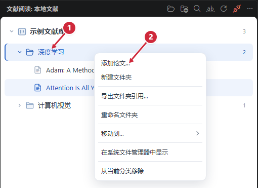
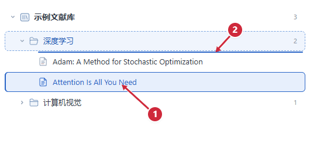
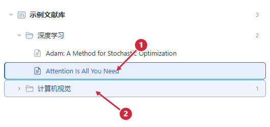
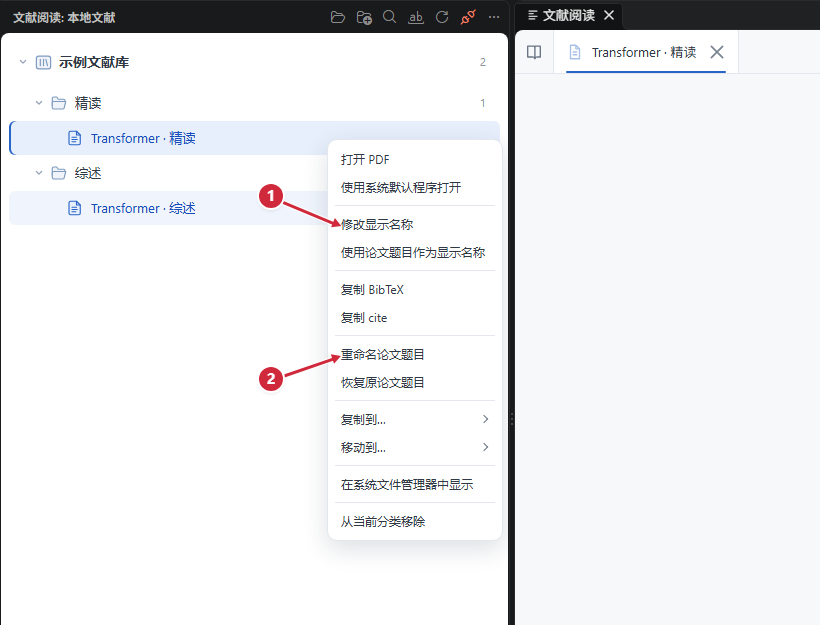
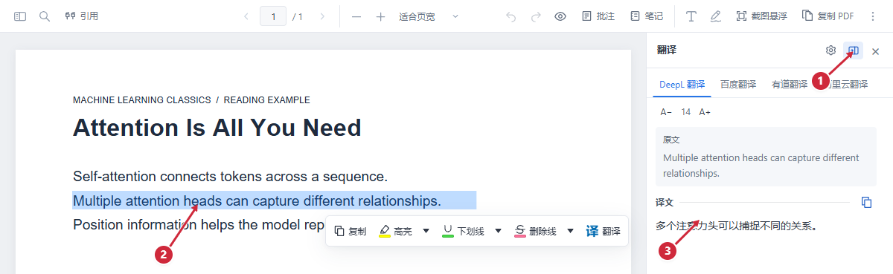
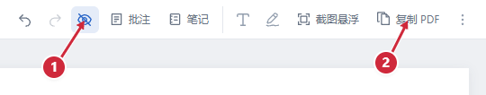
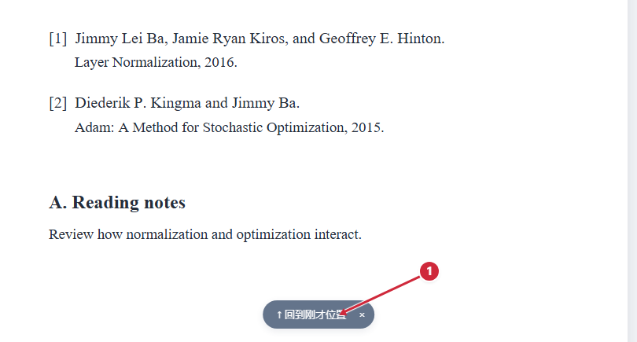
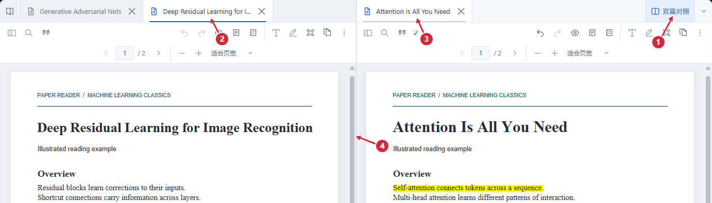
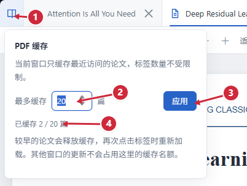

# Paper Reader 使用说明

在 VS Code 中管理本地论文、阅读和批注 PDF。支持 Windows 和 macOS。配图以机器学习经典论文为例，正文与笔记使用演示内容。

## 1. 安装或更新

1. [直接下载 Paper Reader v0.10.100（VSIX）](https://github.com/zkyqust/Paper-Reader-Releases/releases/download/v0.10.100/paper-reader-local-0.10.100.vsix)。
2. 在 VS Code 的「扩展」面板，点 **… → 从 VSIX 安装**，选择下载的文件。
3. 安装后重新加载 VS Code 窗口。

## 2. 打开本地文献文件夹

**这里选择的是 PDF 在电脑上的实际存放位置。** 导入的 PDF 会保存到这个目录或你指定的子文件夹。

1. 第一次使用时，在左侧「文献阅读」点 **打开本地文献文件夹**。可以选一个空文件夹，也可以直接打开已有 PDF 的文件夹。
2. 点顶部的**文件夹图标**可以继续添加，选择窗口也支持一次选中多个文件夹。**多个文献库会同时显示在左侧**，可分别展开和阅读。

## 3. 导入 PDF

1. 在左侧文献列表，**右键点击要接收 PDF 的文件夹**，例如图中的「深度学习」。
2. 在右键菜单中点 **添加论文…**。

3. 确认「添加论文」窗口顶部的 **添加到** 路径，再任选一种方式把文件加入待导入清单。

   1. **直接选择**。点 **选择 PDF** 或 **选择文件夹**，从系统文件选择窗口里选取。
   2. **拖入文件**。把 PDF 或文件夹拖进「拖入 PDF 或文件夹」的虚线区域。
   3. **复制后粘贴**。在文件管理器里复制 PDF 或文件夹，回到「添加论文」点一下虚线区域，再按 Windows 的 `Ctrl+V` 或 macOS 的 `⌘V`。

   选择、拖入或粘贴文件夹时，插件会查找其中的 PDF。
4. 在清单里检查要导入的文件。默认全选，取消勾选可以排除某篇。
5. 点 **完成**。勾选的 PDF 会保存到目标文件夹，并显示在文献列表中。

## 4. 管理和搜索论文

1. 点 **搜索论文**（放大镜），可按显示名称、原文件名或文件夹查找。
2. 想查 PDF 正文时，点 **跨文献全文搜索**（`ab` 图标）。
3. 输入关键词并按 **Enter**。名称搜索会展开匹配的文件夹，直到显示论文。
4. 点击论文即可阅读。点击全文搜索结果可跳到原文。右键论文可修改显示名称、移动或复制到其他分类。

### 拖动论文排序或移动

**在同一文件夹内调整顺序**

1. 按住一篇论文，将它拖到同一文件夹里另一篇论文那一行的上半部或下半部。
2. 看到**蓝色插入线**后松手，论文会排到蓝线所示的位置。

**移动到其他文件夹**

1. 按住要移动的论文，拖到目标文件夹那一行的**中间**。
2. 看到**目标文件夹整行高亮**后松手，论文会移入该文件夹。

### 显示名称和论文题目

1. **修改显示名称**。设置**当前分类中这份 PDF 的显示名**。该分类的文献列表会显示这个名称，从这里打开时，阅读标签也会使用它。每个分类可以分别设置。
2. **论文题目**由插件从 PDF 自动读取，作为**整个文献库（主文件夹及其子分类）中识别论文的唯一标记**，用于分组和查重。不同分类里的同题副本归为一组，按组同步 **PDF 内容、批注和已保存的引用**。识别有误时，可用菜单里的「重命名论文题目」更正。

例如，同一篇《Attention Is All You Need》放在两个分类时，在「综述」中可以显示为「Transformer · 综述」，在「精读」中可以显示为「Transformer · 精读」。

## 5. 阅读、批注和笔记

1. **标记正文**。选中文字后可高亮、加下划线或删除线。每种标记工具可以分别设置常用颜色。选区菜单也支持复制和翻译。
2. **查看批注**。点工具栏的 **批注**，从列表跳回原文或添加附注。批注自动保存到 PDF。
3. **截图悬浮**。点工具栏的 **截图悬浮**，框选内容后会弹出可置顶的桌面浮窗。
4. **复制 PDF**。点工具栏的 **复制 PDF**，然后粘贴到桌面或文件管理器。

### 查看和编辑附注

1. 点摘录可跳回原文。**双击列表里的摘录，或双击 PDF 上已有的高亮、下划线或删除线**，即可查看和编辑附注。
2. 点 **添加附注**，给这条标记写一段批注。

### 论文笔记

1. 点 **批注** 右侧的 **笔记**，打开整篇论文的笔记。
2. 在编辑区写下笔记，可使用标题、项目列表、编号列表、加粗和斜体。如果当前正在预览，点 **编辑** 回到输入区。
3. 点 **预览** 查看排版效果。笔记自动保存到 PDF，下次打开可继续编辑。

### 右侧栏自动翻译

第一次使用时，先选中 PDF 文字，再点选区菜单里的 **翻译**。

1. 点翻译窗右上角的 **侧栏图标**，在浮窗和右侧栏之间切换。插件会记住上次使用的布局。
2. 右侧栏打开时，在 PDF 中选中文字并松开鼠标。
3. 右栏会自动更新原文和译文。使用浮窗时，通过选区菜单的 **翻译** 按钮触发。

支持 DeepL、百度、有道和阿里云，可点翻译窗的齿轮配置。

### 复制 PDF

1. **需要干净副本时**，点眼睛图标隐藏批注。需要保留批注和笔记时，让批注处于显示状态。
2. 点 **复制 PDF**，然后粘贴到桌面或文件夹。批注隐藏时，复制出来的 PDF 会移除批注和论文笔记，原文件继续保留你的记录。

### 跳转参考文献后返回

点击正文里可跳转的参考文献编号，会定位到对应条目。看完后点图中 **① 回到刚才位置**，即可回到点击编号前的页面和滚动位置。

## 6. 双篇对照

1. 打开至少两篇论文，点 **双篇对照**，也可以把一个标签拖到阅读区右侧。
2. 点左侧标签，选择左边要看的论文。
3. 点右侧标签，选择右边要看的论文。**同组内拖动标签可以排序，拖到另一侧可以换组。**
4. 拖动中间分隔线，松开后调整两侧宽度。

## 7. PDF 缓存设置

1. 点文献阅读标签栏左边的书本图标，打开 **PDF 缓存**。
2. 在 **最多缓存** 中输入 `1–100` 篇，默认是 **20 篇**。
3. 点 **应用**，设置生效后弹窗自动收起。
4. **已缓存 2 / 20 篇**表示当前窗口缓存了 2 篇，最多缓存 20 篇。

缓存上限控制最近访问的 PDF 有多少篇留在内存里。上限越小越省内存，较早访问的论文会释放缓存，标签仍可点击，切回时重新加载。**每个窗口独立计数**。双篇对照时会保留正在看的两篇。

## 8. 保存和导出引用

### 保存单篇论文的引用

打开论文，点阅读工具栏里的 **引用**。

1. 在输入框粘贴论文的 BibTeX。
2. 点 **保存**，把引用关联到当前论文。保存后可点 **复制 BibTeX** 或 **复制 cite**。

### 批量导出引用

1. 在左侧右键目标文件夹，点 **导出文件夹引用…**。
2. 勾选要导出的论文，导出为 `.bib` 文件。需要先给论文保存 BibTeX，才能选中导出。

## 9. 跨设备阅读

1. 用 **WPS 云盘或 OneDrive 同步整个文献库文件夹，包括 PDF 和 `.paper-reader/`**。
2. 一台电脑保存并同步完成后，在另一台电脑的插件里打开同步到本地的文献库文件夹。
